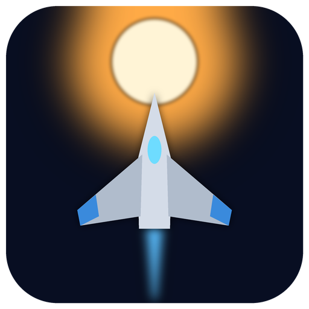

# Zenith Lancer

A vertical scrolling shooter in the tradition of the great 1990s PC shooters, with a workshop between the missions:
a campaign of five episodes and 60 missions across the worlds of the Solenne system, front and rear guns with eleven
power levels, sidekicks, a generator that feeds them all, a shield, specials, log crystals that tell the story,
blueprints for rare gear and secret missions behind hidden beacons. Beside the campaign: an arcade mode for one or two
pilots and a boss rush, seven difficulties, German and English.

**Windows, Linux and the Steam Deck**, free and open source under the AGPL-3.0. Ships, enemies, landscapes and sound
effects are made by the program itself, from plain-text data anybody can change.

 

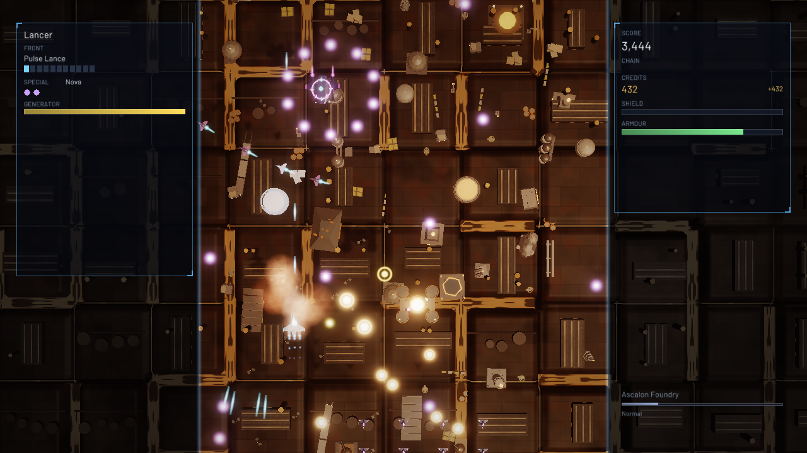

## Download

**[ZenithLancer-1.0.0-windows-x64.zip](https://github.com/reneweller-coding/ZenithLancer/releases/download/v1.0.0/ZenithLancer-1.0.0-windows-x64.zip)**
for Windows 10 and 11: unpack it anywhere and start `ZenithLancer.exe`, nothing to install. The
**[Linux archive](https://github.com/reneweller-coding/ZenithLancer/releases/download/v1.0.0/ZenithLancer-1.0.0-linux-x86_64.tar.gz)**
runs on any x86-64 distribution with glibc 2.35 or newer, SteamOS included. Both carry the player's readme
(`README.txt`), the credits and the licence.

Requirements: a graphics card with OpenGL 3.3; a gamepad, the keyboard or the mouse. The program is not code-signed:
Windows' SmartScreen may warn once ("More info", "Run anyway").

## Pictures

| | |
|:---:|:---:|
| 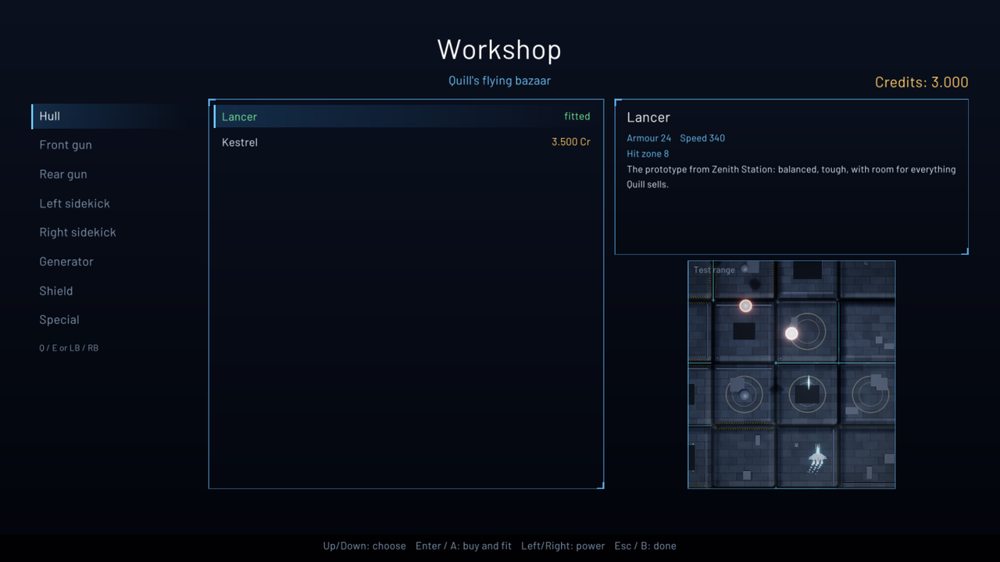 | 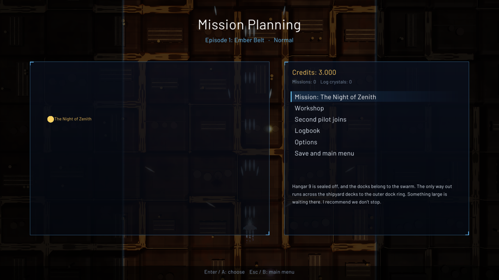 |
| Quill's workshop | The mission plan, where the path forks |
| 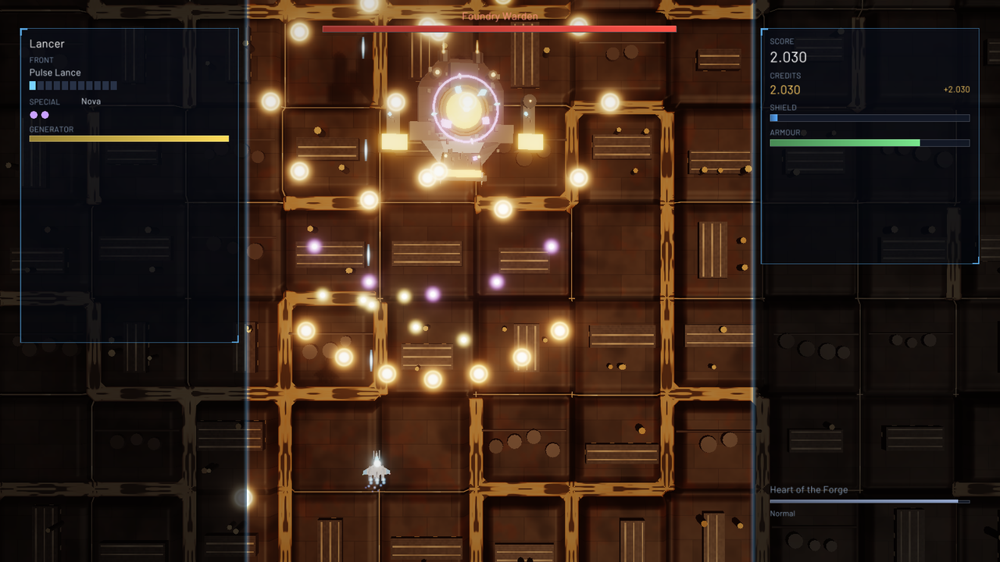 | 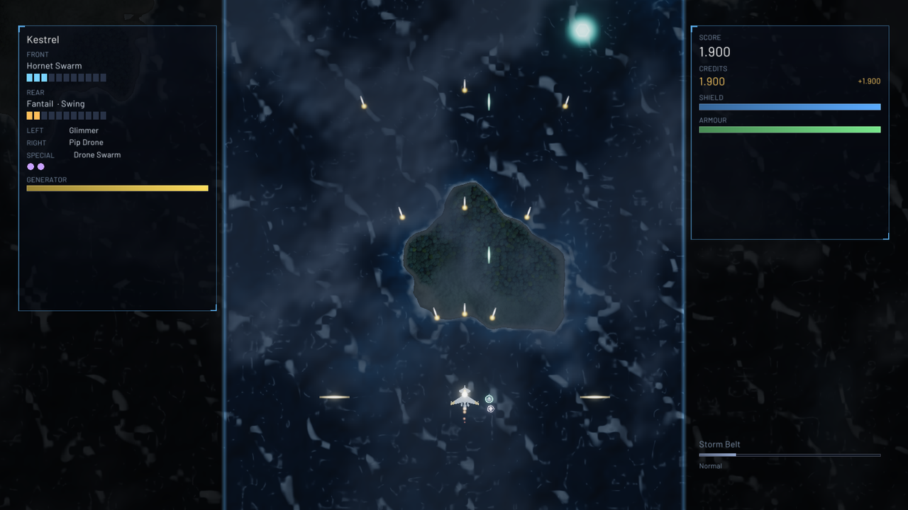 |
| A boss, part by part | The storm belts of Thalassa |
| 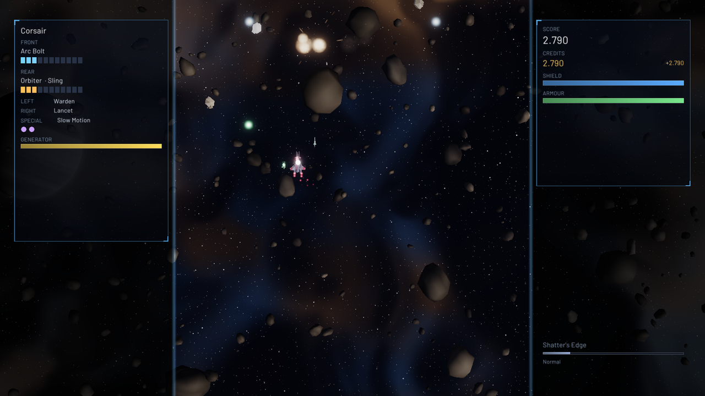 | 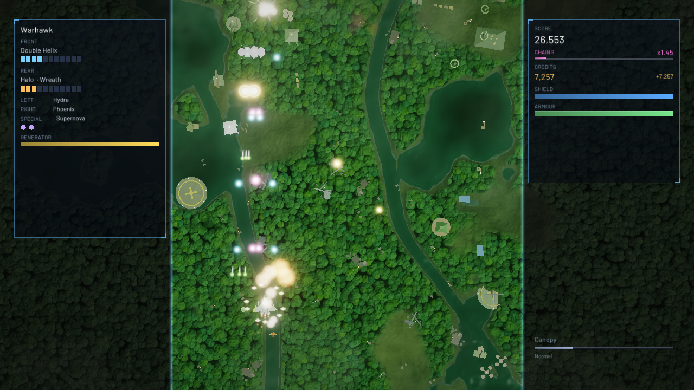 |
| The asteroid belt of the Shatter | The jungle moon Sylvara |
| 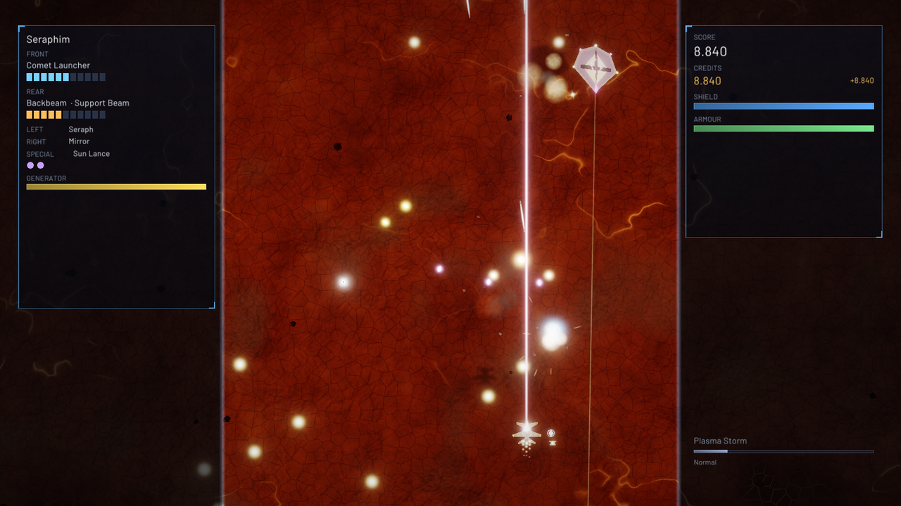 | 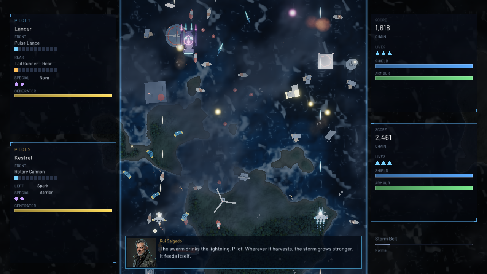 |
| In the corona of Solenne | The campaign for two |
| 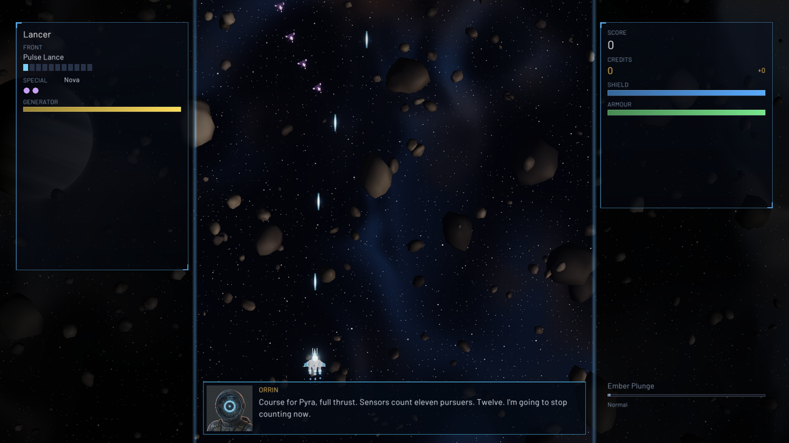 | 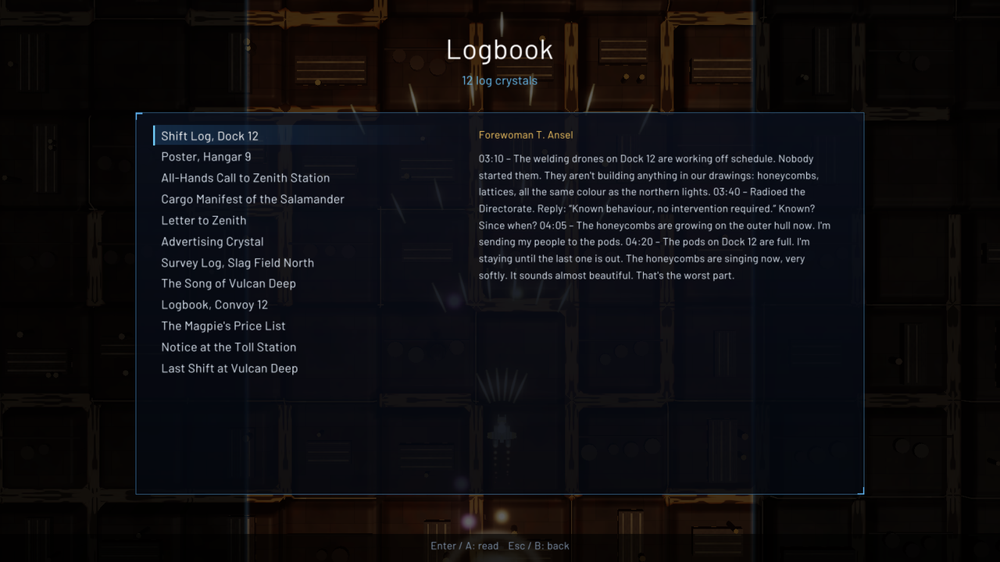 |
| A radio call and its speaker | The log book and its crystals |

## The game

The Solenne system, in the 27th century. A self-replicating terraforming swarm, the Tessellate, has begun to
"optimise" everything into its lattice and is building a crown around the sun. Nadia Vey escapes the fall of Zenith
Station in the prototype Lancer with its on-board mind ORRIN; the smuggler Bastian Quill and his ship-bazaar follow
her from world to world.

- **The campaign:** five episodes (the foundries of Pyra, the ocean world Thalassa, the asteroid belt of the Shatter,
  the jungle moon Sylvara, the sun Solenne), 60 missions with forks in the path and secret missions, bosses in
  several parts, three save slots. A later episode opens once the one before is finished.
- **The workshop:** between the missions Quill sells hulls, front and rear guns with eleven power levels, two
  sidekicks, generators, shields and specials, and takes back what is fitted at full value. The generator feeds the
  guns and the shield: a strong gun needs a strong generator.
- **Log crystals, blueprints, secrets:** crystals tell the world in small pieces (shift logs, letters, the Curator's
  polite messages, Quill's price lists), blueprints open rare gear in the workshop, hidden beacons open secret courses.
- **Arcade** for one or two pilots: six pilots with fixed gear, lives, power-ups and gun pickups from the enemies, best
  scores for each difficulty.
- **Boss rush:** the fourteen great bosses in a row, with full gear.
- **Seven difficulties,** from Cadet to Suicide, and the hidden Zenith beyond.
- **German and English:** the game starts in your system's language (Options > Language).

### New in 1.0.0

- **The campaign for two:** two pilots fly the campaign together, each with their own gear and money; a pilot shot
  down comes back while the other one flies.
- **New Game+:** a finished campaign begins again in episode 1 with all its gear, the enemies tougher.
- **Practice:** any mission you have flown, whole or straight to its boss.
- **Survival:** endless waves and bosses; the daily flight has the same waves for everyone on the same day.
- **Replays** of your runs, **achievements** and **statistics**.
- **Chains and grazes** for the score, a **weekly flight** with house rules and the **ghost** of your best flight.
- A **flight school**, and the **archive**: every enemy met, the music room, paints for your ship.
- **Accessibility:** bullet contrast and colour-blind palettes, the game speed, auto-bomb, reduced flashes.
- **Graphics quality** settings and a **benchmark mode**, made for the Steam Deck.
- **A play log** of your sessions.
- **Mods:** a `mods` folder in your player folder or beside the game, one folder for each mod; `mods/example` shows
  how one is built ([docs/MODDING.md](docs/MODDING.md)).
- **Speaker portraits and voiced radio calls, briefings and endings** (German and English), and **music in layers**
  that rise and fall with the fight.

## Playing

| | Keyboard | Gamepad / Steam Deck |
|---|---|---|
| Fly | Arrows or W A S D | left stick, d-pad |
| Fire | Space, J | A or RT |
| Slow (precise) | Shift, K | LB or LT |
| Switch the rear gun | X, L | B or RB |
| Special weapon | C, I | X or Y |
| Pause | Esc, P | Start |
| Full screen | F11 or Alt+Enter | |
| Screenshot | F12 | |

With mouse control (Options) the ship follows the pointer: the left button fires, the right one switches the rear
gun, the middle one fires the special. Every key and button can be changed under Options > Keys and buttons;
"Autofire" makes the fire button switch firing on and off. Gamepads rumble on hits, explosions and bosses (it can be
switched off).

**Windows:** unpack the zip anywhere and start `ZenithLancer.exe`.

**Linux:** unpack the archive and start `./ZenithLancer`. The program links its C++ runtime statically and needs only
the C library (glibc 2.35 or newer); OpenGL and X11 (or XWayland) are loaded at run time.

**Steam Deck:** in desktop mode, unpack the Linux archive (for instance into `~/Games/ZenithLancer`), add
`ZenithLancer` to Steam with "Add a Non-Steam Game" and start it from Gaming Mode. The game recognises the Deck,
starts in full screen at 1280 x 800 and plays with the Deck's controls (controller template "Gamepad").

Saves, settings, screenshots (`shots`) and crash reports (`crashes`) live in `%APPDATA%\ZenithLancer` on Windows and
in `~/.local/share/ZenithLancer` on Linux and the Deck. [docs/README-player.txt](docs/README-player.txt) is the
player's readme in both languages (`README.txt` in the archives).

## Building

raylib 5.5 is fetched by CMake at configure time; nothing else is needed.

Windows (Visual Studio 2026, CMake 3.22 or newer):

    .\build.ps1                 # Release: bin\msvc\ZenithLancer.exe
    .\build.ps1 -Test -Run      # all tests (the app tests play the screens in a hidden window), then start it

or with the presets: `cmake --preset msvc`, `cmake --build --preset msvc`, `ctest --preset msvc`.

Linux (CMake 3.22 or newer, GCC 12; on Debian and Ubuntu `build-essential g++-12 cmake libx11-dev libxrandr-dev
libxinerama-dev libxcursor-dev libxi-dev libgl1-mesa-dev`):

    CC=gcc-12 CXX=g++-12 cmake --preset linux
    cmake --build --preset linux -j 8         # bin/linux/ZenithLancer
    ctest --preset linux -R "data|missions"   # the headless tests

For the Steam Deck, build on Ubuntu 22.04 (or anything else with glibc 2.35 or older) and copy the result over;
SteamOS is newer and runs it.

Release archives: `.\Deploy\build_release.ps1` builds, tests and packs `dist\ZenithLancer-<version>-windows-x64.zip`
and, through WSL (Ubuntu 22.04), `dist/ZenithLancer-<version>-linux-x86_64.tar.gz`; on Linux,
`bash Deploy/build_linux.sh` makes the second alone. Each holds the program, `data/`, `assets/`, `mods/example`, the
player's `README.txt`, `CREDITS.txt` and `LICENSE`. On GitHub, `.github/workflows/build.yml` builds and tests every
push and pull request, and `.github/workflows/release.yml` builds both archives for a tag `v*` and attaches them to a
draft release. [docs/RELEASE.md](docs/RELEASE.md) is the release checklist.

### Tools

The program carries its own tools; the first four open no window.

    ZenithLancer --validate                     # every data file and reference
    ZenithLancer --simall [--difficulty N] [--episode E] [--mortal] [--loadout "..."]   # autopilot balance runs
    ZenithLancer --weapons                      # every gun's damage and energy a second
    ZenithLancer --langcheck all                # the texts that lack their English
    ZenithLancer --shot work/x.png --level e1_01 --at 60 [--theme lava] [--loadout "..."]
    ZenithLancer --screen shop --shot work/shop.png
    ZenithLancer --gallery work/models.png
    ZenithLancer --apptest tools/apptest_campaign.txt   # with ZENITH_HOME set to a test folder
    ZenithLancer --help

## Folder layout

    src/                 the game, C++20 on raylib: App (the screens), Sim (the game without pictures or sound),
                         Data (reads data/), Forge (models from their lines), Render, Terrain, Audio, Input,
                         Rumble, Save, Files, Lang, Ui, Crash
    data/                everything the game is made of, as plain text: models, enemies, items, levels/e1..e5,
                         episodes, story/de and story/en, lang/en.txt, arcade, difficulty, themes
    assets/              fonts (Barlow), music (OGG), portraits, voice
    res/                 the program's icon
    docs/                DESIGN.md (world, story, goods), DATA.md (the data formats), GLOSSARY.md (the names in
                         both languages), README-player.txt, CREDITS.txt, STORE.md, RELEASE.md, shots/,
                         example_mod/
    tools/               Python helpers: the icon, the music (ACE-Step), music checks, sound measurement, credit
                         scaling, the interface strings, the app-test scripts
    Deploy/              build_release.ps1, build_linux.sh, publish_release.ps1
    .github/workflows/   build.yml (pushes and pull requests), release.yml (tags v*)
    build/ bin/ dist/ work/   made by the builds and the tools, not in git

Missions, enemies and their fire, models, guns and stories are text files; [docs/DATA.md](docs/DATA.md) describes
them, and `ZenithLancer --validate` checks every change. The world, the story and the workshop's goods are in
[docs/DESIGN.md](docs/DESIGN.md).

## Credits and licences

Idea and direction: Rene Weller. Program, world, enemies, guns, missions and texts: Claude (Anthropic) with Rene
Weller. The music was made locally with ACE-Step 1.5, the voices with Qwen3-TTS, the portraits with FLUX.2 [klein] 4B
(each model under the Apache License 2.0). Built on [raylib 5.5](https://www.raylib.com) (zlib licence) and the
libraries it carries; the font is Barlow (SIL Open Font License 1.1, `assets/fonts/Barlow-OFL.txt`).
[docs/CREDITS.txt](docs/CREDITS.txt) lists everything with its licence; the archives carry it beside the game.

Zenith Lancer is free software under the GNU Affero General Public License 3.0 ([LICENSE](LICENSE)): use it, change
it, pass it on, with the source of what you change. That covers the code, the data and the music, voices and
portraits made for the game; the Barlow font keeps its own licence. All characters are fictional.

---

## Deutsch

Ein senkrecht scrollender Shooter in der Tradition der großen PC-Shooter der Neunziger, mit einer Werkstatt zwischen
den Einsätzen: eine Kampagne aus fünf Episoden und 60 Missionen durch das Solenne-System, Front- und Heckkanonen mit
elf Leistungsstufen, Begleiter, ein Generator, der alles speist, Schild und Spezialwaffen, Logkristalle, die die
Geschichte erzählen, Baupläne für seltene Ausrüstung und Geheimmissionen hinter versteckten Peilsignalen. Dazu ein
Arcade-Modus für einen oder zwei Spieler, die Bossjagd, sieben Schwierigkeitsgrade, Deutsch und Englisch.

**Windows, Linux und das Steam Deck**, frei und quelloffen unter der AGPL-3.0. Schiffe, Gegner, Landschaften und
Geräuscheffekte erzeugt das Programm selbst, aus Textdateien, die jeder ändern kann.

### Neu in 1.0.0

- **Die Kampagne zu zweit:** zwei Piloten fliegen die Kampagne gemeinsam, jeder mit eigener Ausrüstung und Kasse; ein
  abgeschossener Pilot kehrt zurück, solange der andere fliegt.
- **Neues Spiel+:** eine beendete Kampagne beginnt mit aller Ausrüstung wieder in Episode 1, die Gegner zäher.
- **Übung:** jeder schon geflogene Einsatz, ganz oder gleich sein Boss.
- **Überleben:** Wellen und Bosse ohne Ende; der Tagesflug hat für alle am selben Tag dieselben Wellen.
- **Wiederholungen** der eigenen Läufe, **Erfolge** und **Statistiken**.
- **Ketten und Streifschüsse** für die Punkte, ein **Wochenflug** mit Sonderregeln und der **Geist** des besten Flugs.
- Eine **Flugschule** und das **Archiv**: jeder getroffene Gegner, das Musikzimmer, Lackierungen fürs Schiff.
- **Barrierefreiheit:** Kugelkontrast und Farbpaletten für Farbfehlsichtige, Spieltempo, automatische Bombe, weniger
  Blitze.
- **Grafikqualität** in Stufen und ein **Benchmark**, gemacht für das Steam Deck.
- **Ein Spielprotokoll** der eigenen Sitzungen.
- **Mods:** ein Ordner `mods` im Spielerordner oder neben dem Spiel, je Mod ein Unterordner; `mods/example` zeigt,
  wie einer gebaut ist ([docs/MODDING.md](docs/MODDING.md)).
- **Porträts der Sprecher und gesprochene Funksprüche,** und **Musik in Schichten**, die mit dem Kampf steigt und
  fällt.

### Herunterladen und starten

- **Windows 10 und 11:** [ZenithLancer-1.0.0-windows-x64.zip](https://github.com/reneweller-coding/ZenithLancer/releases/download/v1.0.0/ZenithLancer-1.0.0-windows-x64.zip)
  irgendwohin entpacken und `ZenithLancer.exe` starten, ohne Installation. Das Programm ist nicht signiert:
  SmartScreen warnt unter Umständen einmal ("Weitere Informationen", "Trotzdem ausführen").
- **Linux** (x86-64, glibc 2.35 oder neuer): [ZenithLancer-1.0.0-linux-x86_64.tar.gz](https://github.com/reneweller-coding/ZenithLancer/releases/download/v1.0.0/ZenithLancer-1.0.0-linux-x86_64.tar.gz)
  entpacken und `./ZenithLancer` starten.
- **Steam Deck:** das Linux-Archiv im Desktop-Modus entpacken, in Steam "Ein Nicht-Steam-Spiel hinzufügen" und
  `ZenithLancer` auswählen. Das Spiel erkennt das Deck, startet im Vollbild (1280 x 800) und spielt sich mit den
  Deck-Knöpfen (Steuerungsvorlage "Gamepad").

Voraussetzungen: eine Grafikkarte mit OpenGL 3.3; Gamepad, Tastatur oder Maus. Die Steuerung steht oben in der
Tabelle und in `README.txt` im Archiv; alle Tasten und Knöpfe lassen sich unter Optionen > Tasten und Knöpfe ändern.
Speicherstände, Einstellungen, Bildschirmfotos und Absturzberichte liegen unter `%APPDATA%\ZenithLancer` (Windows)
bzw. `~/.local/share/ZenithLancer` (Linux, Steam Deck).

### Selbst bauen

Windows mit Visual Studio 2026: `.\build.ps1` (das Spiel landet in `bin\msvc`), `.\build.ps1 -Test -Run` mit allen
Tests. Linux mit GCC 12: `CC=gcc-12 CXX=g++-12 cmake --preset linux`, `cmake --build --preset linux`,
`ctest --preset linux -R "data|missions"`. Die Release-Archive packt `.\Deploy\build_release.ps1` (Linux über WSL)
bzw. `bash Deploy/build_linux.sh`; die Schritte bis zur Veröffentlichung stehen in
[docs/RELEASE.md](docs/RELEASE.md).

### Mitwirkende und Lizenz

Idee und Leitung: Rene Weller. Programm, Welt, Gegner, Waffen, Missionen und Texte: Claude (Anthropic) mit Rene
Weller. Die Musik entstand lokal mit ACE-Step 1.5, die Stimmen mit Qwen3-TTS, die Porträts mit FLUX.2 [klein] 4B
(die Modelle jeweils unter der Apache License 2.0); raylib 5.5 (zlib-Lizenz), die Schrift Barlow (SIL Open Font
License 1.1). Alles Einzelne steht in [docs/CREDITS.txt](docs/CREDITS.txt).

Zenith Lancer ist freie Software unter der GNU Affero General Public License 3.0 ([LICENSE](LICENSE)): benutzen,
ändern, weitergeben, mit dem Quelltext dessen, was man ändert. Das gilt für den Code, die Daten und die für das Spiel
gemachte Musik, Stimmen und Porträts; die Schrift Barlow behält ihre eigene Lizenz. Alle Figuren sind erfunden.
